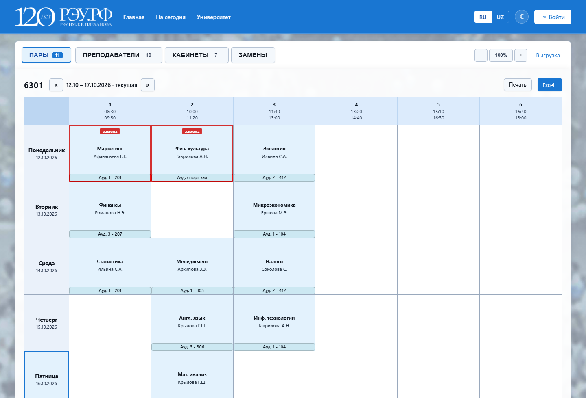
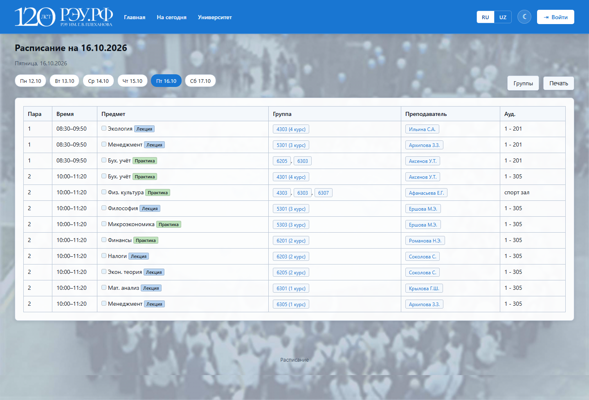
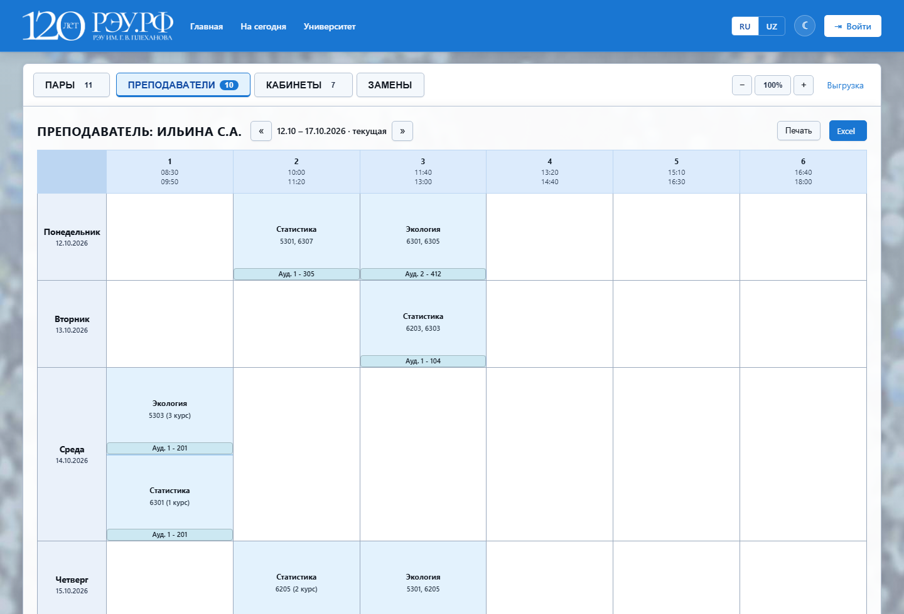
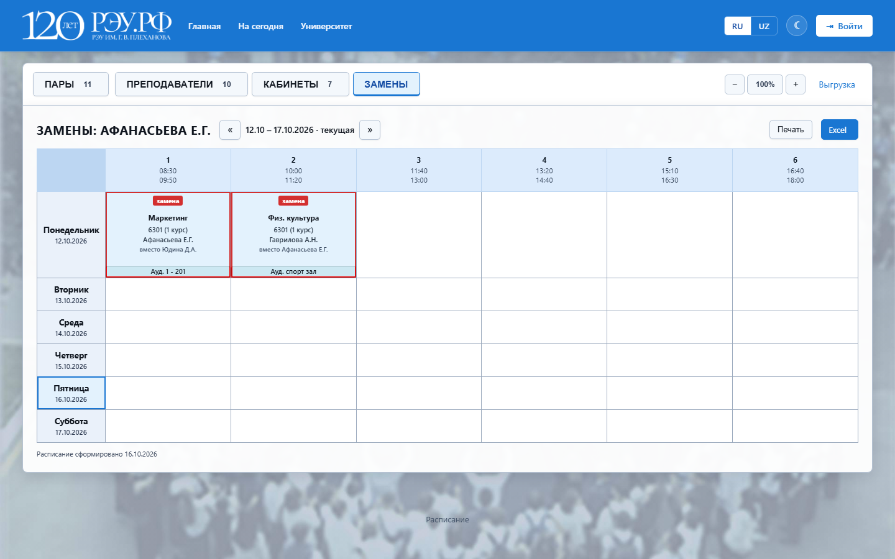
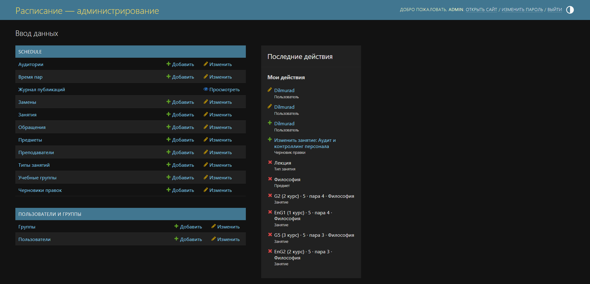
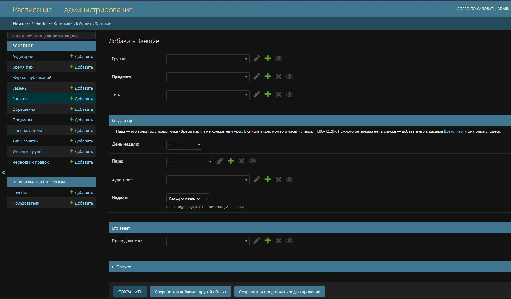

<div align="center">

# Расписание вуза

**Расписание вуза в браузере: загрузка из файла, черновики правок, журнал и откат.**

Django · SQLite · без сборки фронтенда

[](https://github.com/mrdanilov/Platform-for-Plekhanov-University/actions/workflows/tests.yml)
[](https://www.python.org/)
[](https://www.djangoproject.com/)

</div>

---

## Что это

Вместо бумажного расписания на стенде: группа, преподаватель и аудитория
открывают своё расписание в браузере, сотрудница правит его через админку —
без программиста и без Excel.

Django 5.2, база — один файл SQLite, интерфейс на русском и узбекском.
Во фронтенде нет ни сборки, ни npm, ни внешних библиотек: шаблоны Django,
около двухсот строк JavaScript и один файл CSS.

## Возможности

- **Четыре окна:** расписание группы, преподавателя, кабинета и замены.
- **«Сегодня»** — весь вуз за один день.
- **Чётная и нечётная недели** переключаются стрелками, без перезагрузки.
- **Загрузка из файла Excel** одной командой, сначала вхолостую.
- **Черновик перед публикацией:** сотрудница видит результат до того, как он
  появится на сайте.
- **Журнал изменений и откат** любой публикации целиком.
- **Защита от порчи:** дубли в справочниках не появляются, растяжка пары
  проверяется до применения, две одновременные правки замечаются.
- **Выгрузка в Excel и CSV**, печать, масштаб, тёмная тема.

## Скриншоты

Все данные на снимках выдуманные. Наполнить базу так же можно самому:
`python manage.py seed_demo`.













## Что важно в проекте

- **Чётность недели хранится в данных**, а не вычисляется из календаря:
  номера недель вуза и календарные недели не совпадают, и из-за этого
  занятия показывались не в те дни.
- **Публикация идёт через черновик:** публичный сайт нельзя испортить
  недосмотренной правкой.
- **Файл вуза разбирается осторожно:** пропущенные строки считаются, а
  противоречие в шапке останавливает загрузку.
- **Данные проверяются на входе:** дубли, конфликты и битый цвет
  отсекаются в момент записи.

## Стек

Django 5.2 · Python 3.12+ · SQLite · openpyxl · waitress или gunicorn ·
без npm и внешних ресурсов · 900+ автотестов, запуск на каждом push.

## Запуск

```bash
git clone https://github.com/mrdanilov/Platform-for-Plekhanov-University.git
cd Platform-for-Plekhanov-University

python -m venv .venv
.venv/bin/pip install -r requirements.txt      # Windows: .venv\Scripts\pip

.venv/bin/python manage.py migrate
.venv/bin/python manage.py seed_demo            # демо-данные, можно убрать
.venv/bin/python manage.py createsuperuser
.venv/bin/python manage.py runserver
```

Открыть <http://127.0.0.1:8000/>. Показать коллегам по сети:
`python tools/show_lan.py`.

## Документация

| Файл | О чём |
|---|---|
| [`docs/HANDBOOK.md`](docs/HANDBOOK.md) | памятка по коду: запуск, справочники, настройки, бэкап |
| [`OFFICER.md`](OFFICER.md) | инструкция для сотрудницы: как править расписание |
| [`deploy/install.md`](deploy/install.md) | установка на сервер: systemd, nginx, HTTPS |
| [`.env.example`](.env.example) | образец настроек с пояснениями |

## Проверки

```bash
python manage.py test schedule
```

Тесты гоняются на каждом push — см. значок вверху.
